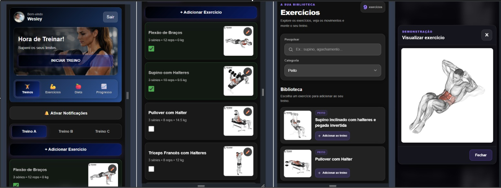

# 💪 Workout App

**Uma aplicação web para gestão de treinos e acompanhamento da rotina fitness.**

O Workout App é um projeto desenvolvido com React, TypeScript e Firebase, com foco em uma experiência moderna, responsiva e preparada para evoluir com novas funcionalidades relacionadas à gestão de treinos.

A aplicação utiliza autenticação com Google, persistência de dados com Firestore e infraestrutura para notificações push.


## Prévia da aplicação




## 📌 Índice

- [Sobre o projeto](#-sobre-o-projeto)
- [Funcionalidades](#-funcionalidades)
- [Tecnologias utilizadas](#-tecnologias-utilizadas)
- [Arquitetura](#-arquitetura)
- [Pré-requisitos](#-pré-requisitos)
- [Instalação](#-instalação)
- [Configuração do Firebase](#-configuração-do-firebase)
- [Executando o projeto](#-executando-o-projeto)
- [Rotas da aplicação](#-rotas-da-aplicação)
- [Notificações push](#-notificações-push)
- [Progressive Web App](#-progressive-web-app)
- [Build de produção](#-build-de-produção)
- [Segurança](#-segurança)
- [Próximas evoluções](#-próximas-evoluções)
- [Contribuição](#-contribuição)
- [Licença](#-licença)

---

## 🎯 Sobre o projeto

O Workout App foi criado para servir como base de uma aplicação de fitness com uma interface moderna, autenticação de usuários e integração com serviços do Firebase.

O projeto utiliza uma arquitetura baseada em componentes React, com TypeScript para tipagem estática e Vite para desenvolvimento e compilação.

A integração com o Firebase permite trabalhar com autenticação, armazenamento de dados e notificações, enquanto a estrutura da aplicação permite adicionar novos módulos conforme o desenvolvimento avança.

### Objetivos

- Oferecer uma interface simples e intuitiva.
- Permitir autenticação segura de usuários.
- Organizar a navegação entre páginas.
- Integrar serviços em nuvem.
- Preparar a aplicação para notificações push.
- Facilitar a manutenção e a expansão do código.

## ✨ Funcionalidades

### Autenticação e acesso

- Autenticação de usuários com Google.
- Gerenciamento do estado de autenticação por meio de um contexto React.
- Integração com Firebase Authentication.
- Proteção das páginas que exigem autenticação.
- Redirecionamento entre as páginas da aplicação.

### Interface e navegação

- Interface desenvolvida com React e TypeScript.
- Estilização com CSS.
- Navegação utilizando React Router.
- Layout adaptável a diferentes tamanhos de tela.
- Identidade visual com tema escuro e detalhes em roxo.

### Dados e serviços

- Integração com Cloud Firestore.
- Configuração de persistência local para permitir acesso aos dados em cenários compatíveis com o modo offline.
- Estrutura para armazenamento e gerenciamento de tokens de notificações.

### Notificações

- Integração com Firebase Cloud Messaging (FCM).
- Registro de tokens dos dispositivos.
- Service worker dedicado ao recebimento de mensagens push.
- Endpoint para envio de notificações por meio de uma integração de servidor.

> **Nota sobre o estado do projeto:** as funcionalidades acima descrevem as integrações conhecidas da aplicação. A implementação completa de módulos de treinos, exercícios, alunos, planos e relatórios deve ser documentada conforme esses recursos forem efetivamente desenvolvidos.

---

## 🛠️ Tecnologias utilizadas

| Tecnologia | Finalidade |
|---|---|
| React 19 | Construção da interface |
| TypeScript | Tipagem estática e manutenção do código |
| Vite 8 | Servidor de desenvolvimento e build |
| React Router 7 | Navegação e gerenciamento de rotas |
| Firebase Authentication | Autenticação de usuários |
| Cloud Firestore | Banco de dados NoSQL |
| Firebase Cloud Messaging | Notificações push |
| Progressive Web App | Recursos de aplicação web instalável |
| CSS | Estilização e identidade visual |
| Node.js e npm | Ambiente de desenvolvimento e gerenciamento de dependências |

---

## 🏗️ Arquitetura

A aplicação é organizada em camadas com responsabilidades distintas:

- **Interface:** páginas, componentes e estilos.
- **Navegação:** definição das rotas e controle de acesso.
- **Autenticação:** contexto responsável pelo estado do usuário.
- **Serviços:** integração com Firebase e demais recursos externos.
- **Notificações:** registro de tokens e comunicação com o serviço de envio.
- **Service workers:** suporte a recursos PWA e notificações em segundo plano, conforme as condições do navegador.

### Fluxo simplificado

```text
Usuário
   |
   v
Interface React
   |
   v
React Router
   |
   v
Contexto de autenticação
   |
   v
Firebase Authentication
   |
   v
Aplicação autenticada
   |
   +----> Cloud Firestore
   |
   +----> Firebase Cloud Messaging
                |
                v
         Serviço de notificações
```

---

## 📋 Pré-requisitos

Antes de começar, instale:

- [Node.js](https://nodejs.org/) — versão compatível com as dependências do projeto.
- npm, incluído com o Node.js.
- [Git](https://git-scm.com/), para clonar o repositório.
- Uma conta Google.
- Um projeto configurado no [Firebase Console](https://console.firebase.google.com/).

Para verificar as instalações:

```bash
node --version
npm --version
git --version
```

---

## 🚀 Instalação

### 1. Clone o repositório

```bash
git clone URL_DO_REPOSITORIO
```

Substitua `URL_DO_REPOSITORIO` pelo endereço real do repositório.

### 2. Acesse a pasta do projeto

```bash
cd workout-app
```

Ajuste o nome da pasta se o repositório utilizar outro nome.

### 3. Instale as dependências

```bash
npm install
```

### 4. Configure as variáveis de ambiente

Crie um arquivo `.env.local` na raiz do projeto e preencha os valores de configuração do Firebase.

Os nomes das variáveis devem corresponder aos utilizados pelo arquivo de inicialização do Firebase da aplicação.

### 5. Inicie o ambiente de desenvolvimento

```bash
npm run dev
```

O Vite apresentará no terminal o endereço local da aplicação, normalmente:

```text
http://localhost:5173
```

Abra o endereço indicado no navegador.

---

## 🔥 Configuração do Firebase

O projeto utiliza Firebase para autenticação, banco de dados e notificações.

### 1. Criar o projeto

1. Acesse o [Firebase Console](https://console.firebase.google.com/).
2. Crie ou selecione o projeto Firebase.
3. Registre uma aplicação Web.
4. Copie os dados de configuração disponibilizados pelo Firebase.

O projeto de Firebase utilizado durante o desenvolvimento é `workout-app-e39a4`. Para executar a aplicação em outro ambiente, utilize a configuração correspondente ao projeto desejado.

### 2. Configurar a autenticação

No Firebase Console:

1. Abra **Authentication**.
2. Acesse os métodos de login.
3. Habilite o provedor Google.
4. Configure o domínio autorizado da aplicação.
5. Verifique a configuração da tela de consentimento e dos dados do provedor, quando aplicável.

A configuração deve corresponder ao fluxo de autenticação implementado no frontend.

### 3. Configurar o Firestore

1. Acesse **Firestore Database**.
2. Crie o banco de dados, caso ainda não exista.
3. Configure as regras de segurança.
4. Garanta que os caminhos e as permissões utilizados pelo código correspondam às regras publicadas.

Não utilize regras abertas de leitura e escrita em produção.

### 4. Configurar as variáveis de ambiente

Exemplo de referência para uma aplicação Vite com Firebase:

```dotenv
VITE_FIREBASE_API_KEY= SUA_API_KEY
VITE_FIREBASE_AUTH_DOMAIN= SEU_AUTH_DOMAIN
VITE_FIREBASE_PROJECT_ID= SEU_PROJECT_ID
VITE_FIREBASE_STORAGE_BUCKET= SEU_STORAGE_BUCKET
VITE_FIREBASE_MESSAGING_SENDER_ID= SEU_MESSAGING_SENDER_ID
VITE_FIREBASE_APP_ID= SEU_APP_ID
VITE_FIREBASE_VAPID_KEY= SUA_CHAVE_PUBLICA_VAPID
```

Remova os espaços depois do sinal de igual ao preencher os valores.

**Importante:** esse exemplo é um modelo de configuração. Confirme os nomes exatos das variáveis em `src/services/firebase.ts` antes de utilizá-lo. Não adicione variáveis que o código não utiliza.

As configurações do Firebase para aplicações web podem ser identificadores públicos, mas isso não substitui as regras de segurança do Firestore nem a proteção dos serviços de backend. Nunca coloque credenciais administrativas, chaves privadas ou tokens secretos em variáveis `VITE_*`.

### 5. Proteger os arquivos locais

Adicione ao `.gitignore`, caso ainda não estejam presentes:

```gitignore
node_modules/
dist/
.env.local
.env.*.local
```

Não publique valores privados de configuração, credenciais de servidor ou tokens de acesso no GitHub.

---

## 🧭 Rotas da aplicação

As rotas conhecidas do projeto são:

| Rota | Finalidade |
|---|---|
| `/` | Página inicial de acesso |
| `/cadastro` | Rota de cadastro existente na estrutura da aplicação; disponibilidade do fluxo depende da configuração atual |
| `/dashboard` | Área principal da aplicação após autenticação |

As permissões de acesso devem ser verificadas pela implementação das rotas protegidas, e não apenas pela presença de links na interface.

---

## 🔔 Notificações push

O projeto utiliza Firebase Cloud Messaging para estruturar o envio e o recebimento de notificações.

### Componentes envolvidos

- `src/services/firebase.ts`: inicialização e configuração dos serviços Firebase.
- `/firebase-messaging-sw.js`: service worker associado ao Firebase Cloud Messaging.
- `/sw.js`: service worker da aplicação.
- `/api/salvar-token`: endpoint associado ao armazenamento dos tokens de dispositivos.
- `/api/enviar-notificacao`: endpoint associado ao envio de notificações.

Os endpoints devem estar disponíveis no serviço de servidor correspondente para que as operações funcionem.

### Fluxo geral

1. O navegador solicita permissão para enviar notificações.
2. A aplicação obtém um token FCM quando as condições necessárias são atendidas.
3. O token é enviado ao serviço responsável pelo registro.
4. O servidor pode utilizar a infraestrutura do Firebase para enviar notificações ao dispositivo.
5. O navegador processa as mensagens de acordo com as permissões, o estado da aplicação e o suporte da plataforma.

### Requisitos adicionais

- Configurar o Firebase Cloud Messaging.
- Gerar e configurar a chave pública VAPID, quando exigida.
- Verificar os caminhos e o conteúdo dos service workers.
- Configurar a autenticação do servidor para o envio de mensagens.
- Testar notificações em um ambiente HTTPS compatível.

O registro de tokens não significa, por si só, que exista um agendador automático de notificações. Rotinas recorrentes, como lembretes diários, precisam de uma implementação específica no backend ou em um serviço de agendamento.

---

## 📱 Progressive Web App

A aplicação utiliza `vite-plugin-pwa` para disponibilizar recursos de Progressive Web App.

Uma PWA pode oferecer recursos como:

- Instalação no dispositivo, quando suportada.
- Experiência semelhante à de uma aplicação instalada.
- Cache de recursos estáticos.
- Estratégias de funcionamento offline, dependendo da configuração.
- Integração com service workers.

O comportamento real depende da configuração do plugin, das estratégias de cache e das condições do navegador. O funcionamento em desenvolvimento pode ser diferente do comportamento em produção.

---

## 🏭 Build de produção

Para gerar a versão de produção:

```bash
npm run build
```

Os arquivos compilados normalmente são gerados na pasta `dist/`.

Para testar localmente a versão compilada:

```bash
npm run preview
```

O endereço será informado pelo Vite no terminal.

Antes de publicar, verifique se as variáveis de ambiente, os domínios autorizados do Firebase, as regras do Firestore e o serviço de notificações estão configurados corretamente.

---

## 🔐 Segurança

A segurança deve ser considerada em todas as camadas da aplicação.

- Utilize regras restritivas no Cloud Firestore.
- Valide as permissões do usuário em operações realizadas no servidor.
- Não exponha credenciais administrativas ou chaves privadas no frontend.
- Proteja os endpoints de registro e envio de notificações contra uso indevido.
- Valide os dados recebidos pelo backend.
- Utilize HTTPS em produção.
- Não confie apenas na interface para impedir acessos não autorizados.
- Evite registrar tokens, credenciais ou dados pessoais desnecessários nos logs.
- Revise as permissões e a configuração dos service workers antes da publicação.

---

## 🗺️ Próximas evoluções

A estrutura do Workout App pode evoluir com módulos adicionais, conforme forem implementados e testados:

- [ ] Cadastro e gerenciamento de exercícios.
- [ ] Criação e organização de fichas de treino.
- [ ] Planejamento de treinos por usuário.
- [ ] Registro do histórico de atividades.
- [ ] Acompanhamento de evolução e desempenho.
- [ ] Calendário e lembretes de treino.
- [ ] Notificações programadas.
- [ ] Relatórios e indicadores de progresso.
- [ ] Testes automatizados.
- [ ] Pipeline de integração e publicação contínua.

Esses itens representam possibilidades de evolução, não uma declaração de que todos já estão disponíveis.

---

## 🤝 Contribuição

Contribuições são bem-vindas.

Para propor uma alteração:

1. Faça um fork do repositório.
2. Crie uma branch para a funcionalidade:

   ```bash
   git checkout -b feature/nova-funcionalidade
   ```

3. Implemente e teste as alterações.
4. Faça um commit descritivo:

   ```bash
   git commit -m "feat: adiciona nova funcionalidade"
   ```

5. Envie a branch para o seu fork.
6. Abra um Pull Request com a descrição das mudanças.

Mantenha o código consistente com a arquitetura existente e evite incluir arquivos de configuração locais ou credenciais.

---

## 📄 Licença

A licença do projeto ainda deve ser definida.

Antes de distribuir ou permitir contribuições externas, adicione um arquivo `LICENSE` com os termos escolhidos para o repositório.

---

## 👨‍💻 Desenvolvimento

**Workout App**

Aplicação web desenvolvida com React, TypeScript, Vite e Firebase.

Para sugestões, dúvidas ou identificação de problemas, utilize a área de Issues do repositório, caso esteja habilitada.

---

*README sujeito a atualizações conforme novas funcionalidades forem implementadas e validadas.*
